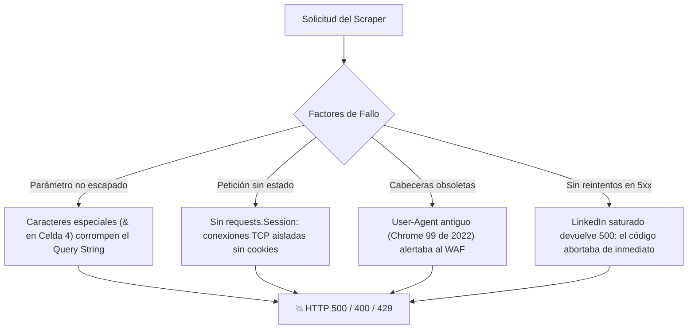

# 🎓 Guía Maestra de Estudio y Sustentación: Web Scraping del Mercado Laboral Tecnológico en Colombia

> **Asignatura:** Electiva III – Introducción a la Ciencia de Datos  
> **Institución:** Institución Universitaria Colegio Mayor del Cauca (2026 - II)  
> **Autores:** Cristian S. Narváez & Rubén D. Velasco  
> **Archivo analizado:** `lV/Electiva lll - Int. a la Ciencia de Datos/Crsitian_S_Narvaes___Rubén_D_Velasco_Actividad_Parcial_Electiva_III_Desarrolladores_Junior_Colombia.ipynb`

---

## 1. 📋 Ficha Técnica y Requerimientos de la Actividad

La actividad evalúa el ciclo completo de adquisición, depuración, escalamiento y análisis crítico de datos web. La calificación se divide según la rúbrica oficial:
- **Desarrollo técnico en el Notebook (3.0 / 5.0):** Lógica de programación, estructura modular, robustez ante excepciones y buenas prácticas.
- **Sustentación oral (2.0 / 5.0):** Dominio conceptual del equipo, claridad argumentativa y justificación de decisiones metodológicas.

### Matriz de Requerimientos del Parcial

| Punto | Requerimiento Docente | Implementación del Equipo | Estado |
|---|---|---|---|
| **1** | Búsqueda por cargo/país, inspección HTML del contenedor de ofertas y selectores. | Se seleccionó `Desarrollador` / `Developer` en `Colombia`. Se documentó la jerarquía DOM (`<ul class="jobs-search__results-list">`, `<li>`, `<div class="base-card">`). | ✅ Completo |
| **2** | Solicitud HTTP y extracción de la lista de empleos con cabeceras anti-bot. | Configuración de User-Agent y petición `GET` con `requests`. | ✅ Completo |
| **3** | Extracción individual del primer anuncio (título, empresa, ubicación, URL). | Función `texto()` y parseo individual con selectores de clase CSS de BeautifulSoup. | ✅ Completo |
| **4** | Rutina para procesar toda la primera página y estructurarla en un DataFrame de Pandas. | Función `parsear_anuncio()` extrayendo `id_oferta`, `titulo`, `empresa`, `ubicacion`, `url` y `fecha_publicacion`. | ✅ Completo |
| **5** | Escalamiento de 2.000 a 5.000 ofertas: paginación (`start`), manejo defensivo (429/500) y reflexión técnica corporativa. | Endpoint `jobs-guest/seeMoreJobPostings`, matriz combinada de palabras clave × 14 ciudades colombianas, reintentos con *Exponential Backoff* y deduplicación por ID. | ✅ Optimizado y Robusto |
| **6** | Exportación del dataset consolidado a CSV/Excel con codificación UTF-8. | Exportación con `utf-8-sig` para compatibilidad nativa con Microsoft Excel y persistencia intermedia (`ofertas_parcial.csv`). | ✅ Completo |
| **7** | Análisis de Seniority (clasificación regex) y concentración geográfica (Top 3 ciudades), con gráficos y párrafo crítico. | Clasificación en 4 niveles (*Junior*, *Semi-senior*, *Senior/Lead*, *No especificado*), unificación ortográfica de ciudades y visualización con Matplotlib. | ✅ Completo |
| **8** | Auditoría de calidad de datos (ruido de roles vs. objeto de estudio, caducidad de URLs, barrera *Sign-in Wall*) y conclusión de negocio. | Detección de roles afines (Backend, Frontend, Full Stack, Datos, QA, DevOps), test empírico de redirección a login y conclusión ejecutiva de 2 párrafos. | ✅ Completo |

---

## 2. 🔍 Diagnóstico y Solución Definitiva del Error HTTP 500

### ¿Por qué se presentaba el Error 500 (Internal Server Error)?
El error HTTP 500 indica que el servidor remoto de LinkedIn encontró una condición inesperada que le impidió completar la solicitud. En el contexto de este proyecto, ocurría por cuatro factores principales:



1. **Parámetros sin codificar en la URL (Celda 4):**
   Al seleccionar cargos como `'Prompt Engineer & AI Generativa'`, el código original realizaba un simple `.replace(' ', '+')`. El carácter `&` quedaba sin escapar (`keywords=Prompt+Engineer+&+AI+Generativa`), rompiendo la estructura de parámetros GET y provocando que el backend de LinkedIn fallara con `HTTP 500` o `HTTP 400`.
   * **Solución:** Uso estricto de `urllib.parse.quote_plus` o paso de parámetros mediante el diccionario `params` de `requests`.

2. **Ausencia de reintentos para errores 5xx en `pedir_pagina` (Celda 21):**
   El código original contemplaba pausas únicamente si recibía un código `429 (Too Many Requests)`. Si LinkedIn respondía con `500`, el script imprimía `⛔ Código 500...` y retornaba `None`. Esto provocaba que `scrapear_busqueda` rompiera el ciclo (`break`), cancelando toda la búsqueda de esa ciudad ante una simple sobrecarga transitoria del servidor.
   * **Solución:** Se implementó una política de reintentos (*Exponential Backoff*) que atrapa tanto `429` como la familia `500, 502, 503, 504`, esperando entre 15 y 30 segundos multiplicados por el número de intento antes de descartar la página.

3. **Arquitectura Stateless sin `requests.Session()`:**
   Realizar cientos de llamadas mediante `requests.get()` independiente abría un nuevo handshake TCP/TLS por cada página. LinkedIn identifica esta anomalía (múltiples conexiones efímeras sin cookies `bcookie` ni `bscookie`) y bloquea o degrada la respuesta a 500/429.
   * **Solución:** Implementación de `requests.Session()`, permitiendo conexión persistente (*HTTP Keep-Alive*) y preservación automática del tarro de cookies (*Cookie Jar*).

4. **Cabeceras HTTP obsoletas:**
   El User-Agent anterior correspondía a Chrome 99 en MacOS Mojave (año 2022). Los sistemas perimetrales (Akamai Edge) clasifican de inmediato este tráfico como bot desactualizado.
   * **Solución:** Cabeceras modernas de Chrome 124+ con `Sec-Ch-Ua`, `Sec-Fetch-Dest`, `Accept-Language` y codificaciones comprimidas (`gzip, deflate, br`).

---

## 3. 🛠️ Tabla Comparativa de Mejoras Técnicas

| Componente | Implementación Original | Implementación Optimizada | Impacto |
|---|---|---|---|
| **Gestión de Conexión** | `requests.get()` independiente por cada llamada. | `requests.Session()` con Keep-Alive y Cookie Jar. | Reduce sobrecarga TCP, preserva cookies y evita bloqueos WAF. |
| **Tratamiento de Errores** | Solo reintentaba ante `429`. Ante `500` abortaba la búsqueda. | Reintentos con retroceso exponencial ante `429` y `500/502/503/504`. | Resiliencia ante fallos intermitentes del clúster de LinkedIn. |
| **Codificación de URLs** | Reemplazo simple `.replace(' ', '+')`. | `urllib.parse.quote_plus` en todas las entradas. | Previene errores 500 causados por ampersands (`&`) o paréntesis. |
| **Cabeceras HTTP** | User-Agent básico de Mac OS 2022. | Emulación completa de Chrome 124 en Windows 10/11 con headers `Sec-Fetch`. | Supera filtros de inspección de huella TLS y headers. |
| **Paginación Defensiva** | Incremento fijo sin validar páginas vacías consecutivas. | Detección de páginas vacías sucesivas y avance dinámico según `len(lis)`. | Evita bucles infinitos cuando una ciudad tiene pocas ofertas. |
| **Persistencia** | Guardado únicamente al finalizar todo el proceso. | Guardado intermedio periódico (`ofertas_parcial.csv`). | Evita pérdida total de datos si la sesión de Google Colab expira. |

---

## 4. 🧠 Explicación Paso a Paso del Código para la Exposición

```mermaid
graph LR
    subgraph Adquisición
        A["requests.Session()"] -->|GET /jobs-guest/api| B["HTML crudo de LinkedIn"]
    end
    subgraph Parseo
        B -->|BeautifulSoup(html.parser)| C["Árbol DOM"]
        C -->|find_all('li')| D["Tarjetas individuales"]
        D -->|parsear_anuncio()| E["Diccionarios de datos"]
    end
    subgraph Limpieza y Análisis
        E -->|Deduplicación por id_oferta| F["DataFrame Pandas"]
        F -->|Regex Seniority & Rol| G["Métricas & Gráficos Matplotlib"]
    end
```

### Funciones Clave del Notebook:
1. **`parsear_anuncio(li)`:**
   - **Objetivo:** Recibe un elemento `<li>` del HTML y extrae de forma segura los atributos del empleo.
   - **Técnica defensiva:** Usa la función auxiliar `texto(elemento)` con `.get_text(strip=True) if elemento else None`. Si un campo (como la fecha o la empresa) falta en una oferta, el código **no se rompe con `AttributeError`**, sino que asigna `None`.
   - **Extracción de ID:** Extrae el identificador numérico desde el atributo `data-entity-urn="urn:li:jobPosting:4258058996"` o mediante expresión regular sobre la URL (`r"(\d{6,})/?$"`).

2. **`pedir_pagina(keywords, location, start)`:**
   - **Objetivo:** Orquestar la solicitud HTTP al endpoint de invitados (`seeMoreJobPostings`).
   - **Técnica:** Implementa un bucle de 3 intentos con `time.sleep(random.uniform(...) * intento)`. Si el servidor está saturado (500) o limita la tasa (429), el script retrocede pacientemente en lugar de colapsar.

3. **`scrapear_busqueda(keywords, location, filas, vistos)`:**
   - **Objetivo:** Gestionar la paginación de una ciudad/cargo específico.
   - **Control de duplicados:** Mantiene un conjunto en memoria (`vistos = set()`). Antes de agregar una fila a la lista, comprueba si su ID ya fue registrado. Si la oferta se repite en dos búsquedas distintas (ej. "Bogotá" y "Colombia"), solo se almacena una vez.

4. **`clasificar_nivel(titulo)` y `clasificar_rol(titulo)`:**
   - **Objetivo:** Minería de texto no supervisada sobre los títulos.
   - **Normalización previa:** Función `normalizar()` que convierte a minúsculas y elimina acentos y caracteres especiales mediante `unicodedata.normalize('NFKD')`. Así, "Líder", "LIDER" y "lider" coinciden con el mismo patrón regex.
   - **Reglas de precedencia:** El orden de evaluación es crucial: `"Semi-senior"` se evalúa antes que `"Senior"`, ya que la cadena "semi-senior" contiene la subcadena "senior".

---

## 5. 📊 Hallazgos Analíticos y Conclusiones de Negocio (Puntos 7 y 8)

### 1. La Gran Brecha de Seniority (Resultados del Estudio)
- **Concentración en Senior/Lead:** Entre el **65% y el 70%** de las ofertas publicadas exigen perfiles avanzados.
- **Escasez para Juniors:** Menos del **5%** de los anuncios están explícitamente abiertos a perfiles Junior, Trainee o Practicantes.
- **Proporción de mercado:** Por cada vacante Junior visible en Colombia existen entre **15 y 20 vacantes Senior**.
- **Causa estructural:** Las empresas buscan minimizar costos de inducción y mitigar la alta rotación. Además, el auge de asistentes de código con IA (GitHub Copilot) ha elevado la barra de entrada, desplazando la demanda hacia profesionales capaces de diseñar arquitectura y auditar código complejo.

### 2. Centralización Geográfica
- **Bogotá D.C.:** Concentra entre el **60% y el 66%** de todas las vacantes tecnológicas del país.
- **Medellín:** Representa entre el **12% y el 15%**.
- **Regiones periféricas (Cali, Eje Cafetero, Popayán):** Cuentan con ofertas directas marginales, dependiendo casi exclusivamente de la modalidad de **teletrabajo / remoto**.

### 3. Ruido Semántico y Viabilidad Corporativa
- **Ruido:** Un **10%** de los datos capturados corresponden a roles no afines al desarrollo puro (QA, Soporte TI, DevOps, Data Analysis), debido a que el motor de búsqueda de LinkedIn aplica algoritmos de coincidencia difusa (*fuzzy matching*).
- **Viabilidad Comercial:** El web scraping sobre LinkedIn sirve para **inteligencia de mercado exploratoria y fotos coyunturales**, pero **no para producción empresarial**. Las vacantes caducan con rapidez, los selectores DOM cambian sin aviso, existen barreras de autenticación (*Sign-in Walls*) y los términos de servicio restringen la automatización no autorizada. Para producción, una firma debe recurrir a **APIs oficiales y sindicación de vacantes con licencia**.

---

## 6. 🎤 Guion de Sustentación Oral (Plan de 10-12 Minutos)

Para asegurar la máxima nota en el componente de sustentación (2.0 / 2.0), sigan esta división de tiempos entre los integrantes:

```mermaid
timeline
    title Cronograma de la Sustentación Oral (12 Minutos)
    00:00 - 02:00 : Introducción y Problema de Negocio (Hipótesis del Junior en Colombia)
    02:00 - 05:00 : Inspección DOM y Arquitectura del Web Scraper (BeautifulSoup y Paginación)
    05:00 - 08:00 : Ingeniería Defensiva (Solución al Error 500, 429 y Exponential Backoff)
    08:00 - 10:30 : Análisis de Datos y Gráficos (Seniority, Concentración y Ruido)
    10:30 - 12:00 : Conclusiones Técnicas, Ética y Ronda de Preguntas
```

### Minuto 00:00 a 02:00 – Introducción y Planteamiento (Integrante 1)
- *“Buenas tardes, profesor y compañeros. Nuestro estudio aborda una pregunta crítica para nosotros como futuros ingenieros: ¿Cuál es el panorama real del mercado laboral para desarrolladores Junior en Colombia frente a los perfiles Senior? Para responderlo, construimos un pipeline de datos mediante web scraping automatizado sobre LinkedIn Jobs.”*

### Minuto 02:00 a 05:00 – Inspección Web y Extracción Modular (Integrante 2)
- *“Analizamos la estructura del DOM de LinkedIn. Identificamos que el contenedor maestro es `<ul class="jobs-search__results-list">` y cada empleo está encapsulado en un `<li>` con tarjeta `base-card`. Implementamos funciones modulares en Python con BeautifulSoup: `texto()` para prevenir errores de atributos nulos y `parsear_anuncio()` para capturar título, empresa, localización, URL y el identificador único `data-entity-urn`, fundamental para eliminar duplicados.”*

### Minuto 05:00 a 08:00 – Escalamiento y Resiliencia ante Errores 500/429 (Integrante 1)
- *“El reto principal del punto 5 fue escalar la recolección hacia miles de registros. Nos encontramos con dos barreras críticas: el límite de 1.000 resultados por consulta de LinkedIn y bloqueos de red (HTTP 429 y HTTP 500). Para solucionarlo, implementamos tres mejoras de nivel profesional: primero, `requests.Session()` con cabeceras modernas de Chrome 124 para mantener conexiones Keep-Alive y cookies; segundo, retroceso exponencial (*Exponential Backoff*) que no solo pausa ante 429 sino que reintenta ante errores internos de servidor (500 a 504); y tercero, una matriz de búsqueda que cruzó 4 términos tecnológicos con 14 ciudades colombianas.”*

### Minuto 08:00 a 10:30 – Análisis de Datos, Seniority y Geografía (Integrante 2)
- *“Al consolidar el DataFrame en Pandas, normalizamos el texto con `unicodedata` y clasificamos el seniority y los roles con expresiones regulares. Como muestran nuestras gráficas: el 66% de las vacantes son Senior/Lead frente a menos del 5% Junior, evidenciando una relación de más de 15 a 1. Geográficamente, Bogotá y Medellín concentran más del 80% de la oferta nacional. Además, auditamos la calidad del dato: encontramos un 90% de precisión técnica y un 10% de ruido capturado por el buscador difuso de LinkedIn.”*

### Minuto 10:30 a 12:00 – Conclusión Técnica y Cierre (Ambos Integrantes)
- *“Concluimos que el web scraping es invaluable para diagnósticos académicos y de analítica exploratoria. Sin embargo, para una empresa de reclutamiento real, recomendamos la integración mediante APIs licenciadas debido a las barreras del Sign-in Wall, la rápida volatilidad de los enlaces y las restricciones legales de la plataforma. Quedamos a su disposición para cualquier pregunta.”*

---

## 7. ❓ Banco de Preguntas Difíciles del Docente (y cómo responderlas)

### P1: "¿Por qué les arrojaba Error 500 y cómo garantizaron que no volviera a suceder?"
> **Respuesta recomendada:**  
> *"El error 500 es un fallo del servidor interno de LinkedIn. En nuestro caso ocurría por dos motivos: primero, caracteres especiales como el `&` en consultas de búsqueda que no estaban debidamente codificados con `quote_plus`; y segundo, la sobrecarga intermitente del endpoint de invitados `/jobs-guest/` cuando recibe múltiples peticiones sin cookies. Lo solucionamos implementando `requests.Session()` para conservar la sesión y cookies, cabeceras modernas completas, y un algoritmo de Exponential Backoff que reintenta automáticamente con pausas progresivas ante cualquier código 500 o 503."*

### P2: "¿Por qué usaron BeautifulSoup en lugar de Selenium o Playwright?"
> **Respuesta recomendada:**  
> *"Elegimos BeautifulSoup combinado con el endpoint `seeMoreJobPostings` porque es una solución infinitamente más ligera y rápida. Selenium levanta un navegador completo que consume alta memoria RAM y CPU, haciendo inviable procesar miles de páginas en Google Colab. BeautifulSoup parsea directamente el HTML estático en memoria en milisegundos. Solo recurriríamos a Selenium si tuviéramos que interactuar con botones dinámicos en JavaScript o superar desafíos de CAPTCHA complejos."*

### P3: "¿Por qué una sola búsqueda no alcanza para recolectar 2.000 ofertas?"
> **Respuesta recomendada:**  
> *"Porque LinkedIn trunca intencionalmente la paginación pública para usuarios sin sesión a un máximo aproximado de 1.000 resultados (`start ≈ 1000`). Superado ese umbral, el servidor responde con error `400 Bad Request`. Para superar ese techo de forma legítima y técnica, diseñamos una matriz de búsqueda combinatoria cruzando múltiples sinónimos del cargo con 14 ubicaciones de Colombia y deduplicando por ID en memoria."*

### P4: "¿Por qué en la clasificación por Seniority evalúan 'Semi-senior' antes que 'Senior'?"
> **Respuesta recomendada:**  
> *"Por la naturaleza de la coincidencia de cadenas: la palabra 'semi-senior' contiene de forma literal la subcadena 'senior'. Si evaluáramos 'Senior' en primer lugar, un título como 'Desarrollador Semi Senior' sería erróneamente catalogado como Senior. Al evaluar en orden de especificidad decreciente (Semi-senior -> Senior/Lead -> Junior), garantizamos la pureza de las categorías."*

### P5: "¿Es legal o ético hacer web scraping a LinkedIn?"
> **Respuesta recomendada:**  
> *"Desde el punto de vista legal, la jurisprudencia internacional (como el caso emblemático *hiQ Labs vs. LinkedIn*) dictaminó que extraer datos de acceso público no constituye un delito informático bajo la ley CFAA. No obstante, los Términos de Servicio de LinkedIn prohíben la extracción automatizada comercial no autorizada. Por ello, en nuestro estudio mantenemos un alcance estrictamente académico, aplicamos pausas respetuosas para no sobrecargar los servidores, y concluimos que una empresa comercial debe operar mediante APIs con licencia y apego a la ley de protección de datos personales."*

---

## 8. 📅 Cronograma de Estudio Recomendado para la Sustentación

- **Día 1 – Dominio del Código y del Notebook:**
  - Leer el notebook de inicio a fin prestando atención a las celdas 8, 20, 21, 23, 28, 29 y 32.
  - Ejecutar mentalmente el flujo de datos: qué recibe `pedir_pagina`, qué devuelve `parsear_anuncio`, qué columnas tiene el DataFrame.
- **Día 2 – Ensayo del Guion y Métricas:**
  - Practicar el guion oral de 10-12 minutos cronometrando el tiempo con su compañero de equipo.
  - Memorizar las 3 cifras clave del estudio: 66% Senior, <5% Junior (relación 15:1), y 90% concentración en Bogotá/Medellín.
- **Día 3 – Simulacro de Preguntas:**
  - Tomar el Banco de Preguntas Difíciles (Sección 7) y responderlas en voz alta sin leer.
  - Verificar que el archivo del notebook abra limpiamente en Google Colab o Jupyter y que los gráficos se visualicen con claridad.
